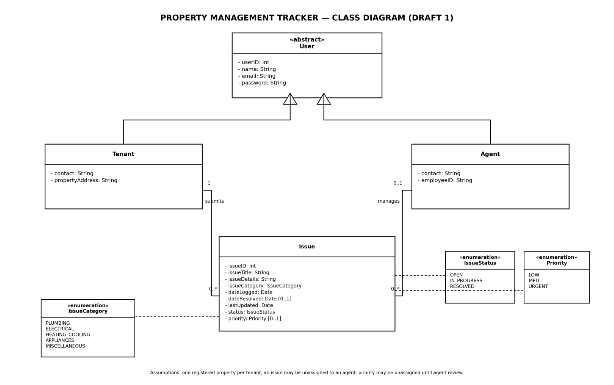
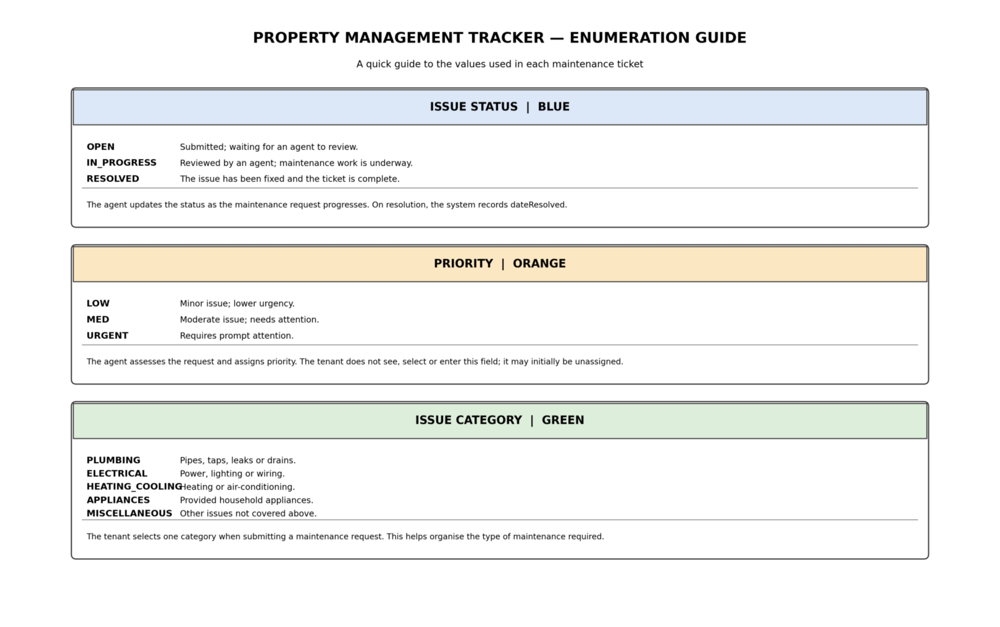
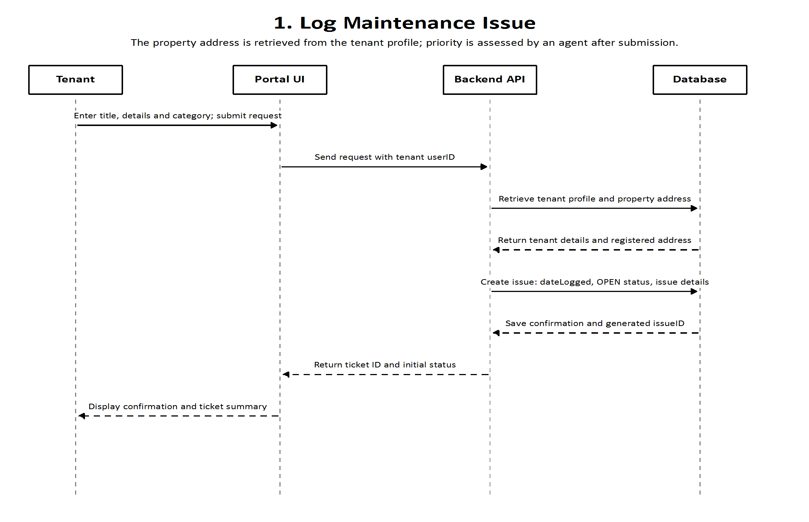
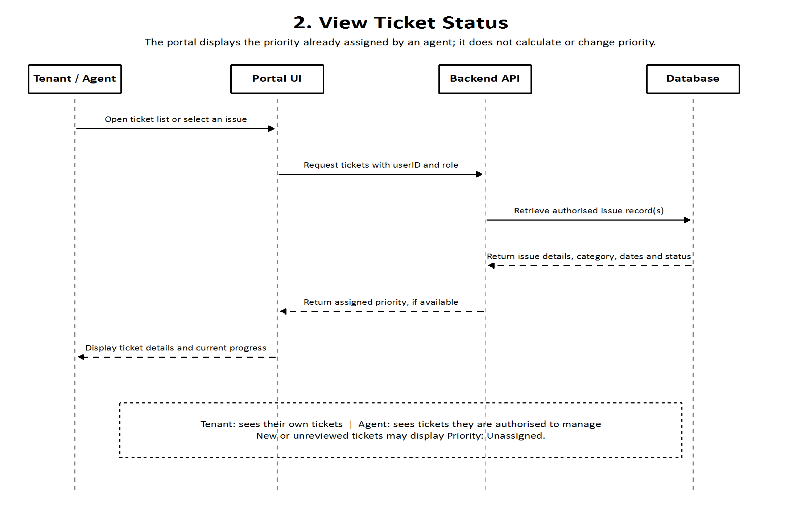
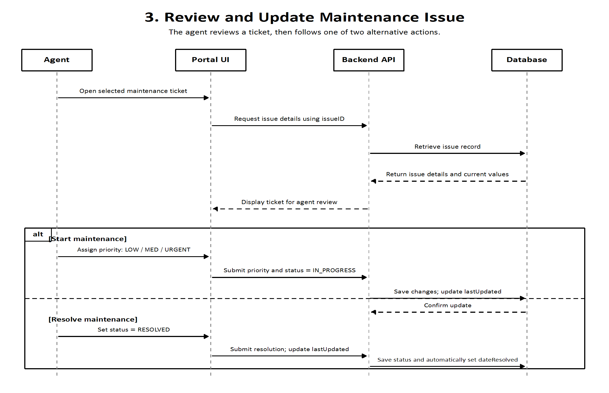

# 🏠 [App Name] — Property Management Tracker

> **Project name:** [App Name] (working title: Property Management Tracker). Final name to be confirmed before prototype launch.

A simple maintenance management platform that helps tenants report property issues and gives property agents a clear way to review, prioritise and resolve them.

The goal is to keep maintenance requests organised, make their progress easy to follow, and preserve a clear record of completed work.

---

## ✨ Features

### For tenants
- Sign in to a personal account.
- Submit a maintenance request with a title, category and description.
- View submitted requests and track their status.
- See the priority assigned by the property agent.
- Review resolved requests and their resolution dates.

### For property agents
- View maintenance requests assigned to them.
- Review tenant, property and issue details.
- Assign a priority to new requests.
- Move issues into maintenance.
- Mark completed work as resolved.
- View resolved requests as read-only history.

---

## 🔄 How It Works

Every maintenance request follows the same three-stage workflow:

`OPEN` → `IN_PROGRESS` → `RESOLVED`

| Status | Meaning | Available action |
|---|---|---|
| **OPEN** | A tenant has submitted a new request. It is waiting for agent review. | Assign a priority and start maintenance. |
| **IN_PROGRESS** | The agent has reviewed the request and maintenance is underway. | Mark as resolved. |
| **RESOLVED** | The maintenance request has been completed. | View the record or return to the dashboard. |

A new issue is automatically created with the `OPEN` status. Its priority remains unassigned until an agent reviews it.

When an agent marks an issue as resolved, the system records the resolution date and updates the `lastUpdated` timestamp. Resolved issues are retained as read-only records.

---

## 🧱 Application Structure

The prototype is intentionally kept small so that its core functionality can be built and tested within the planned development timeframe.

### Core screens

The application uses a maximum of **three core screen templates**:

1. **Login** – Shared sign-in screen for tenants and agents.
2. **Dashboard** – Shows maintenance requests relevant to the signed-in user.
3. **Issue Details** – Used to submit, view and manage maintenance requests.

The dashboard and issue-details screens adapt to the user's role and the issue's current status. These are variations of the same core screens, not additional screen templates.

### Data model

The design uses a maximum of **three database entities**. The current model has two:

| Entity | Purpose |
|---|---|
| `User` | Stores account details and the user's role. |
| `Issue` | Stores maintenance request details, status, priority and relevant dates. |

Tenants and agents are represented as roles within the `User` model, rather than separate database entities.

### Issue information

A maintenance record includes:
- Issue ID and title
- Tenant and property address
- Issue category and description
- Date reported
- Current status and assigned priority
- Last updated date
- Date resolved, once completed

---

## 🔐 Security & Responsible Use

The application handles account details, tenant information and property addresses. That information should only be accessible to people who need it to use the system.

Our approach is to:
- Restrict tenants to viewing their own maintenance requests.
- Restrict agents to requests assigned to them.
- Protect account credentials and use appropriate authentication.
- Validate information submitted through the application.
- Use safe database access methods to reduce the risk of injection attacks.
- Review and test AI-assisted code before it is incorporated into the project.

Security is part of the development process, not something added at the end. The implementation should be reviewed and tested before the application is used with real user information.

### Privacy & Ethics

We aim to handle personal information with care and use it only for the purposes of managing maintenance requests.

Our approach is guided by the **[ACM Code of Ethics and Professional Conduct](https://www.acm.org/code-of-ethics)**, particularly its principles on avoiding harm, being honest and trustworthy, respecting privacy, protecting confidentiality, and building secure systems.

In practice, this means:
- **Purposeful data use:** Collect and use only the information needed to operate the maintenance service. Tenant details and property information are not to be exploited or used for unrelated purposes.
- **Privacy and confidentiality:** Keep personal information private and prevent access or disclosure without authorisation.
- **Appropriate access:** Make information available according to each user's role and responsibilities.
- **Honest communication:** Represent the application's capabilities and limitations accurately.
- **Responsible development:** Consider how design and implementation decisions could affect tenants and agents, and address foreseeable risks.

We do not intend to sell, exploit or use users' personal information for unrelated purposes. The team is responsible for making sure the implemented application reflects these commitments.

---

## 🧪 Testing & AI Code Review

This section records the testing carried out before the prototype is presented or released. Complete the dates, outcomes and notes as testing progresses. Only mark a test as passed once it has actually been performed and its result has been checked.

### Application Testing Log

| Test area | What will be checked | Test date | Result | Notes / fixes |
|---|---|---|---|---|
| Login & authentication | Valid and invalid login attempts; correct dashboard displayed for each role. | 26/11/2026 | [PASS] | Three seeded users can log in properly, bounced back when it is not correct credentials. Register also works. Tenant and agent are directed to correct dashboard accordingly |
| Tenant issue submission | Required fields, successful issue creation, automatic `OPEN` status and date logged. | [DD/MM/YYYY] | [Pending / Pass / Fail] | [Add notes] |
| Tenant access control | Tenant can view their own requests but cannot access another tenant's requests. | [DD/MM/YYYY] | [Pending / Pass / Fail] | [Add notes] |
| Agent access control | Agent can view and manage only the requests assigned to them. | [DD/MM/YYYY] | [Pending / Pass / Fail] | [Add notes] |
| Priority & status workflow | Agent can assign priority and move an issue through `OPEN` → `IN_PROGRESS` → `RESOLVED` in the intended order. | [DD/MM/YYYY] | [Pending / Pass / Fail] | [Add notes] |
| Resolution history | `dateResolved` and `lastUpdated` are recorded correctly; resolved issues are read-only. | 26/11/2026 | [PASS] | Fix issue #13, now dates on dateRosolved and dateUpdated are working correctly |
| Input validation & security | Missing or invalid input is handled; role restrictions work; database input is handled safely. | [DD/MM/YYYY] | [Pending / Pass / Fail] | [Add notes] |
| Usability & compatibility | Navigation, readability and layout on the browsers and devices selected for testing. | 26/11/2026 | [PASS] | Check all button and links, all are working properly. Missing field is also handled. |

### AI-Generated Code Review Log

AI-assisted code must be manually reviewed by a team member before it is merged or included in the prototype. The reviewer should understand what the code does and check its correctness, security and suitability for the project.

| Code / component reviewed | Reviewer | Manual review date | Issues found / changes made | Review outcome |
|---|---|---|---|---|
| [File, feature or component] | [Name] | [DD/MM/YYYY] | [Record findings and fixes] | [Approved / Further work required] |
| [File, feature or component] | [Name] | [DD/MM/YYYY] | [Record findings and fixes] | [Approved / Further work required] |
| [File, feature or component] | [Name] | [DD/MM/YYYY] | [Record findings and fixes] | [Approved / Further work required] |

### OWASP TOP 10

The following assessment uses the OWASP Top 10:2025 as its reference framework, prioritising vulnerabilities relevant to the application's architecture and functionality. The application uses:
Frontend: HTML, CSS and JavaScript
Authentication: Supabase Authentication
Database: Supabase PostgreSQL
Hosting: GitHub Pages

Not all OWASP categories are equally applicable to this prototype. Testing therefore focuses on relevant security risks categories rather than attempting to assess every category exhaustively.

| OWASP Category | Review date | Review notes/outcome |
|---|---|---|
| A01 – Broken Access Control | 26/11/2026 | Verify that users can only access and perform actions permitted by their assigned roles. We have two tenants and one agents. Each tenant cannot see the other's issue and tenant can't access agent's dashboard. |
| A02 – Security Misconfiguration | 25/11/2026 | We are using Supabase that has Row Level Security (RLS) enabled where each table/row modification is constrained by rules which is enabled by default. The Supabase access also only limited to the three developers. |
| A05 – Injection | 26/11/2026 | The login page is tested agaisnt common injection of "' OR '1'='1" and it successfully blocked the log in. |
| A06 – Insecure Design | 25/11/2026 | Similar to A01, the design of the application is modular such that tenant's and agent's flow in different transition. Some of the design, for example date resolution logic, is automated by system where the date are not user based, but system based such that no date tampering possible hence the data integrity is kept.  |
| A07 – Authentication Failures | 25/11/2026 | Using the three users, we erify that authentication and session management behave as expected. Invalid credentials blocking, log out, and the apps remember past data. |
| A08 – Software or Data Integrity Failures | 26/11/2026 | Along with good Access Control and good Secure Design, unauthorised users cannot manipulate application data through modified requests hence kept the data integrity. |
| A10 – Mishandling of Exceptional Conditions | 26/11/2026 | The application, through help of Supabase default design, handles invalid inputs, unexpected states and failed operations; and able to log and send out error message to the front end as well. |

### Testing Summary

- **Testing period:** 25/11/2026 - 02/12/2026
- **Final test date:** 02/12/2026
- **Outstanding issues:** None, pending v2 of the prototype design.
- **Release / presentation decision:** v1 of the prototype is now released at ....
- **Reviewed by:** Chandra Muliawan, Jefferson Pardo, and Manasa Vidya

---

## 🚧 Project Status

**Status:** Prototype in development

The initial scope covers user login, role-based dashboards, maintenance issue submission, agent review, status updates and resolved-issue history.

The prototype is limited to three core screens and no more than three database entities. Features such as mobile applications, contractor access, contractor scheduling, real-time notifications, online payments and advanced analytics are outside the current scope.

---

## 🚀 Future Development

The current prototype focuses on the essential maintenance-request workflow: **Tenant reports → Agent reviews → Agent manages → Issue resolved.** The ideas below are potential next steps for developing the prototype into a more complete property maintenance management platform. They are future opportunities, not features included in the current build.

### 1. Mobile Application & Media Support

Develop a dedicated mobile application to make maintenance reporting and follow-up more convenient. Tenants could take or upload photos and short videos of an issue directly from their phones, while agents could review evidence and manage requests while on the move. Push notifications could keep tenants and agents informed when a request is accepted, assigned, updated or resolved.

**Further planning:** [Define target platforms, user workflows, supported media types, notification events and privacy requirements.]

### 2. Third-Party Maintenance Contractor Portal

Introduce a dedicated portal for external maintenance contractors. Contractors could see relevant available jobs based on their trade and designated service areas. For example, a plumbing contractor servicing Brunswick could view plumbing requests in that area after a property agent has reviewed and accepted them. Contractors could then accept or decline jobs, coordinate visits and submit completion notes or photos.

Access would need to be limited to jobs that match each contractor's trade, service area and permissions; contractors should not automatically have access to every maintenance request in their suburb.

**Further planning:** [Define contractor profiles, trade categories, service areas, job visibility rules, acceptance process and completion reporting.]

### 3. Maintenance Scheduling & Workflow Automation

Expand the maintenance workflow to support appointment coordination between property agents, tenants and contractors. The system could track proposed and confirmed visit times, contractor progress and completion updates. Notifications could be triggered by important events, reducing manual follow-up and keeping everyone involved informed.

**Further planning:** [Define appointment workflows, who can schedule or change visits, status updates, notification channels and how scheduling connects with the contractor portal.]

### Longer-term direction

Together, these enhancements could evolve the prototype from a basic issue-tracking tool into a connected maintenance platform:

**Tenant → Property Agent → Maintenance Contractor → Completed Maintenance**

These enhancements are outside the current prototype scope. Each would need to be assessed separately for development effort, data-model changes, privacy, security and access control. In particular, a mobile app and contractor portal would introduce additional user workflows and testing requirements beyond the current three-screen and three-entity constraints.

---

## 📝 Development Notes

AI tools may be used to support implementation and debugging. Any AI-generated code must be reviewed by the team, tested and understood before it is merged into the project. The team remains responsible for the code that is delivered.

---

## 👤 About the Creator

**CHANDRA MULIAWAN - DHE26010008**

served as the Project Manager and Application Testing Lead for this prototype, overseeing project coordination, development progress, and software testing. Interested in developing practical solutions that simplify property maintenance workflows and improve communication between tenants, property agents, and maintenance teams.

**JEFFERSON PARDO - DHE260100xx**

[Add a short 2–3 sentence bio. You may include relevant study or professional background, technical interests, and your role in designing or developing this prototype.]

**MANASA VIDYA - DHE260100xx**

[Add a short 2–3 sentence bio. You may include relevant study or professional background, technical interests, and your role in designing or developing this prototype.]

---

## 📐 UML Diagrams

The diagrams below describe the planned structure and behaviour of the current prototype.

### Class Diagram

Shows the main classes, their attributes, relationships and issue-related enumerations.

### Sequence Diagrams

Illustrate the main interactions between users, the portal, the backend and the database.

#### 1. Log a Maintenance Issue

#### 2. View Ticket Status

#### 3. Review and Update an Issue

---
